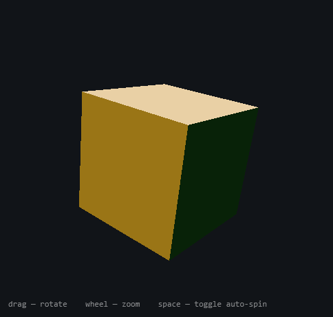

# 3D in WPF, from Scratch

> A walk-through of WPF's retained-mode 3D using `Viewport3D` — building a cube out of raw triangles,
> lighting it, and making it spin and respond to the mouse. The aim is to understand the 3D scene
> graph WPF gives you "for free," not to write a game engine.

*By Richard Potter. The source discussed here lives in this repository under `src/WpfCube/`.*



**Contents**

- [Introduction](#introduction)
- [The scene graph](#the-scene-graph)
- [A face is four points and two triangles](#a-face-is-four-points-and-two-triangles)
- [Winding: why half your cube goes missing](#winding-why-half-your-cube-goes-missing)
- [Normals and light](#normals-and-light)
- [Making it move](#making-it-move)
- [Dragging it: quaternions](#dragging-it-quaternions)
- [Running it](#running-it)
- [Going further](#going-further)
- [Summary](#summary)

---

## Introduction

Most people meet 3D through a heavyweight engine. But Windows has had a perfectly good **retained-mode
3D scene graph** built into WPF since 2006, and it is a wonderful place to *learn* 3D because it makes
you state the fundamentals explicitly — points, triangles, normals, materials, lights, a camera — while
handling the rendering, depth-sorting and animation plumbing for you.

This tutorial builds a spinning, draggable cube. The original version of this demo declared all six
faces by hand in XAML and — as is almost traditional for a first 3D cube — got the triangle winding
wrong on several of them, so the cube was lit from the inside and looked broken from some angles. We
will build the cube *correctly* and, just as importantly, understand **why** the broken version was
broken.

## The scene graph

A WPF 3D scene lives inside a `Viewport3D`, a normal 2D control you can drop anywhere in your UI. It
needs three kinds of thing:

- a **camera** — where you look from, and with what lens;
- one or more **lights** — without light, every surface is black;
- some **models** — the geometry, each with a material.

In [`MainWindow.xaml`](src/WpfCube/MainWindow.xaml) the camera and lights are declared in XAML because
they rarely change:

```xml
<Viewport3D.Camera>
    <PerspectiveCamera Position="0,0,-6" LookDirection="0,0,1" UpDirection="0,1,0" FieldOfView="50" />
</Viewport3D.Camera>
```

The camera sits at `z = -6` looking back toward the origin along `+Z`. (WPF is right-handed, so `+Z`
comes *out of the screen toward you* in the usual convention — placing the camera on the negative side
and looking positive is one consistent way to frame an object at the origin.)

## A face is four points and two triangles

All GPU geometry is triangles. A square face is two of them sharing a diagonal. So one cube face is
four corner points plus two triangles expressed as **indices** into those points:

```
   D --- C        positions: A B C D
   |  \  |        triangle 1: A B C   (indices 0 1 2)
   A --- B        triangle 2: A C D   (indices 0 2 3)
```

Rather than hand-write that six times in XAML, [`CubeMesh`](src/WpfCube/CubeMesh.cs) states each face
once as data — a normal, a colour and four corners — and builds the `MeshGeometry3D` in a loop:

```csharp
foreach (var corner in new[] { face.A, face.B, face.C, face.D })
{
    mesh.Positions.Add(corner);
    mesh.Normals.Add(face.Normal);
}
foreach (var index in new[] { 0, 1, 2, 0, 2, 3 })
    mesh.TriangleIndices.Add(index);
```

Building geometry in code rather than XAML isn't just less typing — it lets us *guarantee* the two
rules below, which are exactly the rules the original hand-written cube broke.

## Winding: why half your cube goes missing

Here is the single most common 3D-beginner bug. A triangle has two sides, but a solid object only
ever shows you the *outside* of its surface, so renderers don't waste time drawing the side you can't
see. WPF decides which side is the "front" from the **order the vertices are listed**: a triangle is
front-facing when its vertices appear **counter-clockwise as seen from the outside**.

List a face's corners clockwise by mistake and that face becomes invisible from outside — you see
straight through into the cube. That is precisely what happened to the original demo.

The fix is a rule you can actually check. For every face, the cross product of two edges must point the
*same way* as the outward normal:

> `(B − A) × (C − A)` must equal the face's outward normal.

`CubeMesh` lays out all six faces to satisfy that, so they all face outward. It's worth verifying one
by hand — the front (`+Z`) face has corners `A(-1,-1,1) B(1,-1,1) C(1,1,1)`, giving
`(2,0,0) × (2,2,0) = (0,0,4)` — a `+Z` normal, pointing at the camera. Front-facing. ✔

## Normals and light

A **normal** is the unit vector sticking straight out of a surface; it is what lighting maths uses to
work out how much a face catches the light. WPF can guess normals, but for a cube you want *flat*
faces, so we give each vertex the face's true normal explicitly (the inner loop above). All four
corners of a face share one normal — that is what makes the face read as flat rather than subtly
rounded.

With honest normals, two lights are enough to model the form:

```xml
<AmbientLight Color="#404040" />                             <!-- fill: nothing is ever pure black -->
<DirectionalLight Color="#D0D0D0" Direction="-0.5,-1,1" />    <!-- key: gives the cube its shading -->
```

Ambient light alone gives a flat, cardboard cube; the directional light is what makes adjacent faces
differ in brightness and the shape "pop."

## Making it move

The cube's orientation is a single `QuaternionRotation3D` on its transform. A `DispatcherTimer` ticking
at ~60 fps nudges it a little each frame:

```csharp
_spinTimer = new DispatcherTimer(DispatcherPriority.Render) { Interval = TimeSpan.FromMilliseconds(16) };
_spinTimer.Tick += (_, _) => Spin(new Vector3D(0, 1, 0), AutoSpinDegrees);
```

(The original used a XAML `Storyboard` animating an angle. A timer is used here instead because it
composes cleanly with *interactive* rotation — the same `Spin` call serves both the clock and the
mouse.)

## Dragging it: quaternions

To rotate by dragging, you might reach for two angles — yaw and pitch. That works until you tumble the
cube around and the two axes line up, at which point control collapses (**gimbal lock**). The robust
tool is the **quaternion**: a compact, lock-free representation of orientation that composes by
multiplication.

Each mouse move turns the drag delta into a small rotation and *pre-multiplies* it onto the current
orientation:

```csharp
private void Spin(Vector3D axis, double degrees)
{
    var delta = new Quaternion(axis, degrees);
    Rotation.Quaternion = delta * Rotation.Quaternion;   // delta first → turn in the viewer's frame
}
```

Order matters. Putting `delta` on the **left** applies it in the *viewer's* frame, so dragging right
always spins the cube right no matter how it is already oriented — the trackball feel. Multiply the
other way and the turn happens in the cube's own (already-rotated) frame, which feels wrong.

Horizontal drag yaws about world-up `(0,1,0)`, vertical drag pitches about world-right `(1,0,0)`, and
the mouse wheel slides the camera along its look direction (clamped so you can't fly through the cube).

## Running it

Requires the [.NET 8 SDK](https://dotnet.microsoft.com/download) (or newer) on Windows.

```bash
cd src/WpfCube
dotnet run
```

| Input | Action |
| --- | --- |
| **drag** | rotate the cube (trackball) |
| **wheel** | zoom in / out |
| **space** | toggle auto-spin |

## Going further

- **Texture a face** with an `ImageBrush` inside the `DiffuseMaterial`, and add texture coordinates
  (`MeshGeometry3D.TextureCoordinates`) to map it.
- **Add specular highlights** with a `SpecularMaterial` in a `MaterialGroup` for a glossy look.
- **Build other primitives** the same data-driven way — a tetrahedron, a grid, a sphere by
  subdivision — reusing the face-builder idea.
- **Hit-test** with `VisualTreeHelper.HitTest`'s 3D overload to pick the face under the cursor.

## Summary

WPF's `Viewport3D` is a genuinely good teacher because it refuses to hide the fundamentals: you spell
out points, triangles, winding, normals, materials, lights and a camera, and in return you get a
real-time, depth-sorted, animatable 3D scene inside an ordinary window. Get the **winding** right so
your faces face outward, give them honest **normals** so they light correctly, and reach for a
**quaternion** the moment a human starts rotating things — and the cube behaves.
